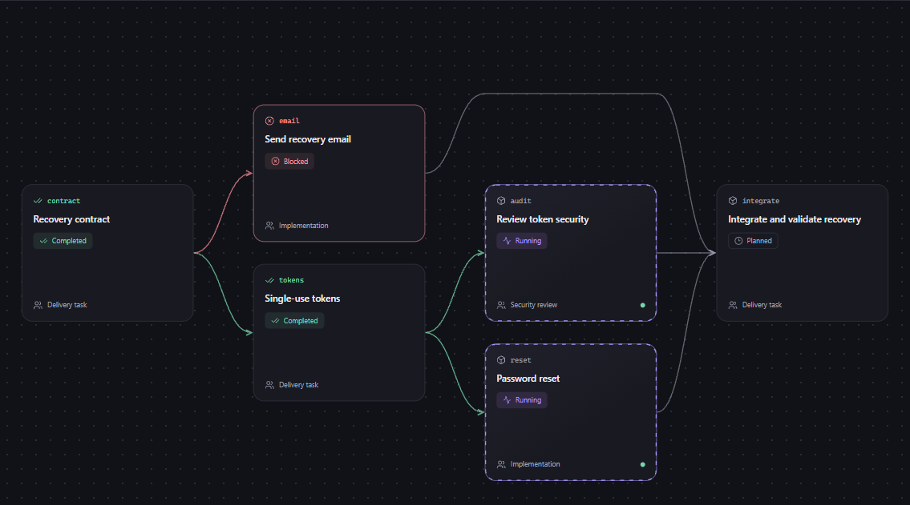
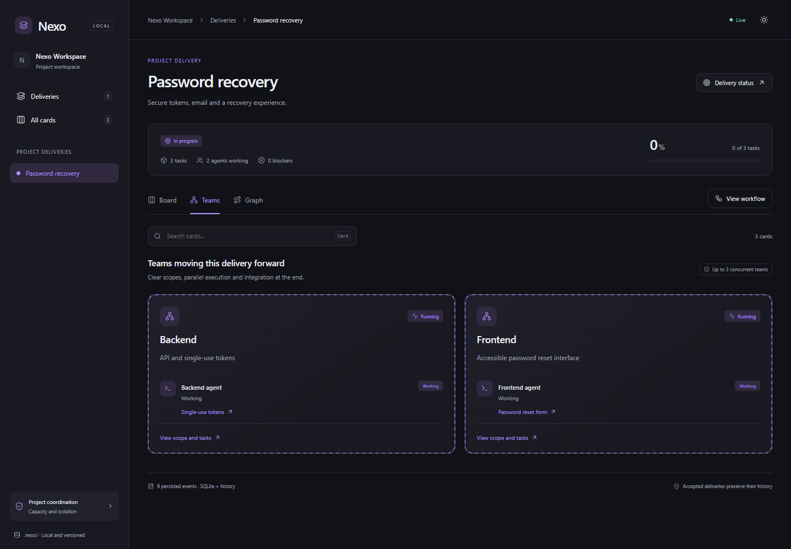
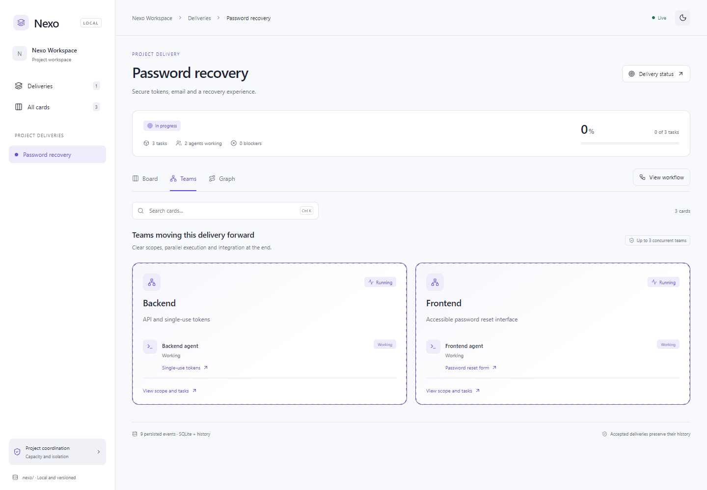
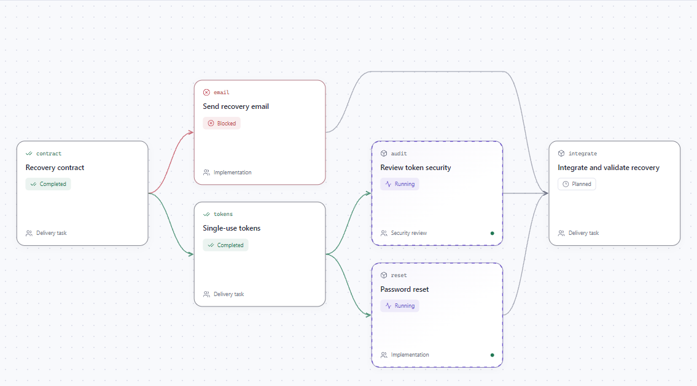
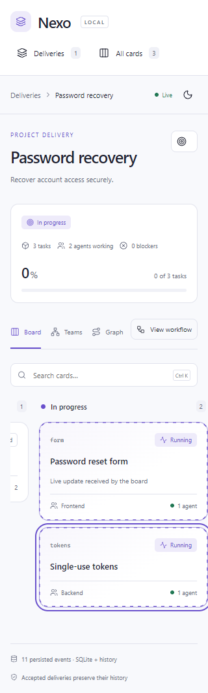

# Nexo

**See how parallel agent work connects to the delivery.**

Nexo is a local Claude Code plugin with a live browser board for deliveries, hierarchical tasks, dependencies, teams and active agents. Plans and history belong to your project. Agent ownership is coordinated through expiring leases in SQLite.

[Install](#get-started) · [How it works](#from-a-delivery-to-the-agents-working-on-it) · [Concurrency and recovery](docs/CONCURRENCY.md) · [Validation](docs/VALIDATION.md) · [MIT license](LICENSE)



_Screenshots use example project data. The interface, instructions and project scaffolding use English. Agents respond in your language._

## From a delivery to the agents working on it

Running several agents creates a coordination problem: what are they building together, who owns each task, and what must finish before the next task can start?

Nexo makes those relationships explicit:

```text
Project
└── Delivery: password recovery
    ├── Task: recovery API
    │   ├── Subtask: single-use tokens
    │   └── Subtask: recovery email
    ├── Task: reset form
    └── Task: integrate and validate
        depends on the API and reset form

Teams and agents are attached to the delivery's tasks.
```

**Hierarchy describes what belongs together. Dependencies describe what must happen first.** They are stored separately and have separate graph views. A parent card summarizes its subtasks; the dependency view shows branching and joining execution paths without repeating each prerequisite card.

Each delivery has its own board, teams and graph. Completing one delivery preserves its result; a later request can create another delivery linked to the previous one.

## What you can see and coordinate

| Capability                                           | What it helps you understand                                                       |
| ---------------------------------------------------- | ---------------------------------------------------------------------------------- |
| Hierarchical cards and leaf-based progress           | How individual tasks contribute to a larger result without double-counting parents |
| Dependency graph and explicit blockers               | Which work can proceed and which work is waiting                                   |
| Teams, active agents and current activities          | Who is working on each card and where work is happening in parallel                |
| Configurable columns and validation stages           | How the workflow fits this delivery rather than a fixed universal template         |
| Task, delivery and workflow modals                   | Criteria, evidence, results and relationships without leaving the board            |
| Live updates, dark/light themes, zoom and fullscreen | A navigable view of the project as work changes                                    |

The intended benefit is less manual reconstruction of status from separate conversations. **There is no measured claim of token savings, faster delivery or improved model accuracy.** The validation report separates local measurements from untested scale assumptions.



<details>
<summary>More English screenshots: light theme and mobile</summary>







</details>

## Get started

Requirements: **Node.js 24.22.x**, **Claude Code 2.1.316 or later**, and Git. The runtime and browser assets are bundled; using the plugin does not require pnpm or a separate web deployment.

In Claude Code:

```text
/plugin marketplace add heamaral/nexo-claude
/plugin install nexo@nexo-marketplace
```

Configure the plugin's `node_path` with your Node 24 executable if it is not the default on Claude's PATH. Then, from a project directory:

```text
/nexo:init
/nexo:plan Implement password recovery with tests and review
/board
```

`/nexo:board` always provides the namespaced command. Initialization creates `/board` as a project alias without overwriting an existing command. This is a **Claude Code plugin**, not a general Claude Desktop chat extension.

For a local checkout:

```sh
claude --plugin-dir ./plugins/nexo
```

To update an existing user-scoped installation:

```sh
claude plugin marketplace update nexo-marketplace
claude plugin update nexo@nexo-marketplace --scope user
```

Use the installation's actual scope if it is `project` or `local`. Run `/reload-plugins` in the relevant Claude sessions and reopen `/board`.

## Coordination backed by state

The planner organizes deliveries, task hierarchy, dependencies and teams. Workers and reviewers claim tasks with explicit identities and scopes, renew their leases during work, and release them when finished. Nexo records ownership; an agent response alone does not establish completion.

- One active executor per task, with explicit collaborators and reviewers.
- Expiring leases, fencing and overlapping write-scope checks.
- Expected entity versions and idempotent command IDs to reject accidental overwrites.
- Cycle, dependency, blocker, evidence and accepted-delivery checks.
- One writer per directory, with crash-released ownership locks.
- A separate snapshot publisher with bounded asynchronous retries; a sharing violation does not stop agent heartbeats.

These are application-level checks. **They do not sandbox shell commands or prove that an implementation is correct.** A recorded commit is evidence to review, not proof that a feature works. See [security boundaries](SECURITY.md).

Use separate worktrees for parallel teams writing code. To coordinate several worktrees through one board, set `NEXO_PROJECT_ROOT` to the coordinator checkout and `NEXO_WORKSPACE` to the team's worktree. The CLI `run` helper acquires a lease before launching an independent Claude session; see [architecture and operation](docs/ARCHITECTURE.md).

Nexo teams are logical coordination groups. They do not enable experimental Claude Agent Teams or change the Claude client's own concurrency limits.

## Project-owned data

```text
your-project/
├── .claude/
│   ├── commands/board.md
│   └── rules/nexo.md
└── .nexo/
    ├── project.json       # Project identity and capacity settings
    ├── project.sqlite     # Closed, tracked snapshot without runtime credentials
    ├── events/            # Immutable JSON events for history and reconstruction
    ├── resolutions.json   # Explicit conflict acknowledgments, when needed
    └── local/             # Git-ignored live SQLite, leases, tokens and logs
```

Run `snapshot` before committing durable Nexo data. SQLite binaries cannot be semantically merged by Git; event history supports reconstruction and explicit conflict handling. Never commit `.nexo/local/` or put secrets in cards and evidence.

The board service binds to `127.0.0.1`. The browser is an authenticated, read-only view; updates flow through MCP. Nexo does not require a hosted Nexo service. Claude itself remains subject to the services and settings you use.

## Release status and validation

**Release candidate, not a stable production guarantee.** The core suite covers ownership, leases, recovery, event conflicts, snapshots and HTTP/MCP behavior on Windows, Linux and macOS. Browser scenarios cover live updates, graphs, themes, modals and responsive layouts. A Windows test reproduces a real file-sharing violation during snapshot replacement.

See [validation evidence](docs/VALIDATION.md) and [remaining stable-release criteria](docs/RELEASE.md). A full implementation pilot, clean-machine recovery and large-project SLO validation remain outstanding. Snapshot construction and event replay still perform synchronous local SQLite work. There is no distributed scheduler or network multiuser service.

## Development

```sh
corepack pnpm install --frozen-lockfile
pnpm check
pnpm test:browser
pnpm validate:plugin
```

Source lives in `src/`; the bundled marketplace runtime lives in `plugins/nexo/runtime/`. [API](docs/API.md), [language policy](docs/LANGUAGE.md), and [concurrency and recovery](docs/CONCURRENCY.md) describe the current implementation. The documentation and example screenshots use English.

## License

Nexo is licensed under [MIT](LICENSE). Bundled dependencies retain their original licenses; see [third-party notices](THIRD_PARTY_NOTICES.md).
