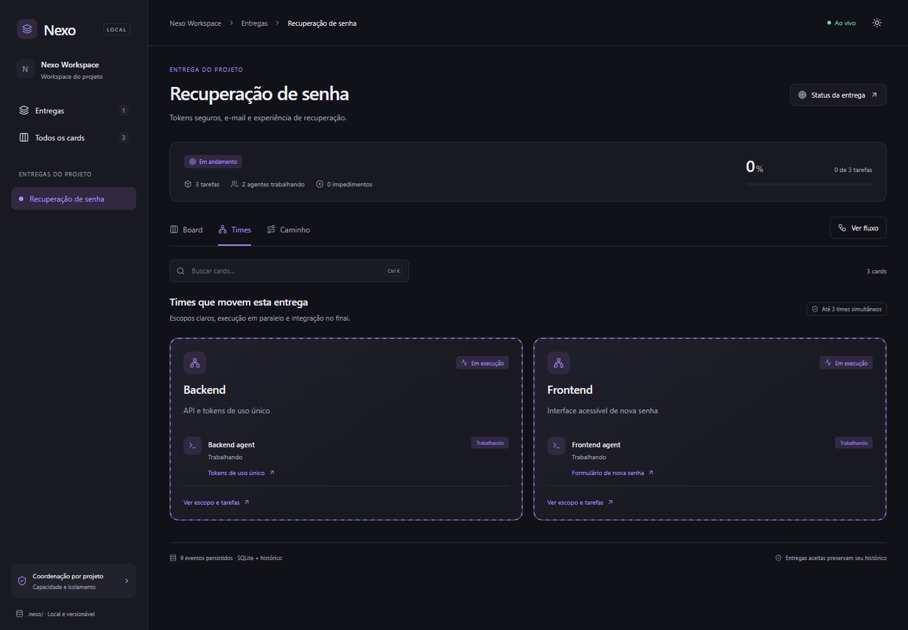
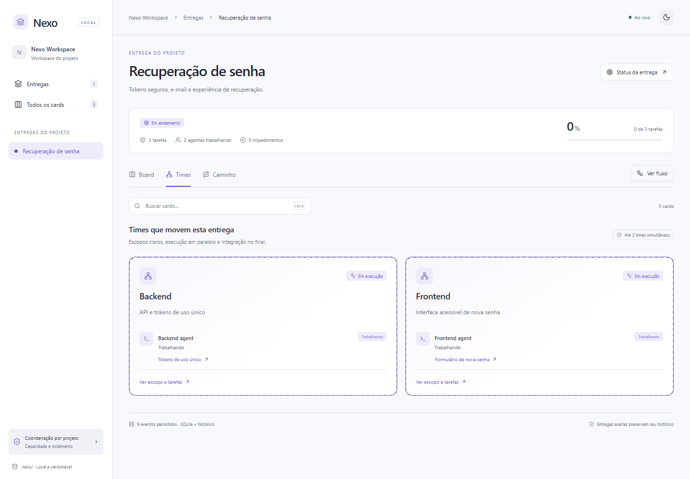

# Nexo

**Do plano à entrega, com contexto.** Kanban local e coordenação de agentes para Claude Code, com histórico pertencente ao projeto.



## Estado da versão

`1.0.0-rc.1` é uma release candidate funcional, com testes automatizados de persistência, concorrência, segurança HTTP, MCP e navegador. O lifecycle nativo com planner/worker e duas sessões em worktrees foi validado. A promoção estável depende do CI nas plataformas suportadas e de um piloto completo de implementação e integração. Não há alegação de suporte ilimitado de escala ou de isolamento de sistema operacional por leases.

## Instalação

Requisitos: **Node.js 24.22.x LTS** disponível no PATH do Claude, **Claude Code >= 2.1.316**, Git e acesso ao repositório privado. O plugin não precisa de pnpm nem baixa dependências em seu primeiro uso.

No Claude Code:

```text
/plugin marketplace add heamaral/nexo-claude
/plugin install nexo@nexo-marketplace
```

No diretório do projeto:

```text
/nexo:init
/nexo:plan Implementar recuperação de senha com testes e revisão
/board
```

Se o Node 24 não for o padrão do sistema, configure o executável na instalação: `claude plugin install nexo --marketplace heamaral/nexo-claude --config node_path=/caminho/para/node`. Caminhos com espaços devem ser passados entre aspas. Isso configura apenas o plugin.

O comando do plugin é `/nexo:board`. A inicialização também cria o alias de projeto `/board` em `.claude/commands/board.md`, sem sobrescrever um comando existente. Comandos ficam no menu de slash commands; o plugin não modifica o menu nativo do aplicativo Claude Desktop. Este pacote é para **Claude Code**, inclusive o ambiente Code dentro do Desktop quando ele oferece plugins, e não uma extensão `.mcpb` de chat comum.

Para teste local sem instalar o marketplace:

```sh
claude --plugin-dir /caminho/nexo-claude/plugins/nexo
```

## O que pertence a cada projeto

```text
meu-projeto/
├── .claude/
│   ├── commands/board.md
│   └── rules/nexo.md
└── .nexo/
    ├── project.json          # identidade, versão e limites do projeto
    ├── project.sqlite        # snapshot fechado, commitável, sem runtime
    ├── events/<uuid>.json    # histórico imutável e reconstruível
    ├── resolutions.json      # reconhecimentos explícitos de conflitos, se houver
    ├── .gitignore
    ├── .gitattributes
    └── local/                # ignorado: WAL, leases, tokens, porta, logs
```

Commit os arquivos duráveis e as regras do projeto. Execute a ferramenta `snapshot` antes do commit para garantir um SQLite atualizado. Os eventos são gravados antes da confirmação do comando e o snapshot é atualizado automaticamente com debounce. O serviço recupera uma transação local ainda não exportada após reinício. O Git não faz merge semântico de SQLite: use os eventos para reconstruir depois de conflitos.

SQLite é adequado para consultas relacionais, hierarquia e transações locais. A busca usa FTS5; embeddings não são necessários para dependências, estados ou coordenação. O adaptador usa `node:sqlite` da linha Node 24, cuja API ainda é release candidate; o major suportado fica fixo até validação de migração.

## Experiência do board

- Portfólio de entregas, com resultado e fluxo preservados após aceitação.
- Dentro de cada entrega: **Board, Times e Caminho**. Agentes sempre têm contexto de entrega/card.
- Colunas e gates configuráveis no workflow da entrega pelo Claude.
- Cards com critérios, dependências, bloqueio vermelho, subtarefas, evidências e resultado em modal.
- Progresso conta folhas, sem somar pais e filhos duas vezes.
- Times e cards com agentes ativos têm borda tracejada animada; respeita movimento reduzido.
- Temas claro/escuro, busca, navegação por teclado, modais nativos e layout responsivo.
- SSE para atualização imediata; watcher e reconciliação periódica importam alterações externas/Git. Ao reconectar, o board busca o estado atual completo, evitando depender de eventos de rede perdidos.



## Planejamento e paralelismo

O agente `nexo:planner` organiza entregas, times, cards e dependências; `nexo:worker` e `nexo:reviewer` executam trabalho com escopo explícito. Os hooks injetam identidades, exigem claim antes de ferramentas de escrita/shell, renovam leases durante ferramentas e liberam o vínculo no final da resposta. Card concluído exige resultado e evidência; gates exigem um SHA de commit. O sistema valida o formato e os pré-requisitos, mas a revisão humana/IA é responsável por verificar que a evidência corresponde ao resultado real.

Cada card tem um executor e pode ter colaboradores/revisores explícitos. Escritores com caminhos sobrepostos são serializados. Todos os agentes registrados contam para a capacidade do projeto e dos times. Limites padrão de Nexo são política configurável do produto, não limites do Claude. Não há scheduler global de conta Anthropic entre máquinas/projetos.

Use worktrees para times independentes. Para uma sessão de terminal independente apontar ao board coordenador, use `NEXO_PROJECT_ROOT` com caminho absoluto; `NEXO_WORKSPACE` indica seu worktree. O helper abaixo registra a sessão antes de iniciá-la, fixa um orçamento e libera o vínculo ao sair:

```sh
node /caminho/plugins/nexo/runtime/cli.mjs run \
  --project /repo-principal --workspace /worktrees/backend \
  --task api --team backend --scope src/api,tests/api \
  --prompt-file /caminho/tarefa.txt --max-budget-usd 10
```

Ele usa `claude -p`, permissões normais e o plugin explícito; não contorna restrições de sessões aninhadas nem habilita Agent Teams experimentalmente. Execute em terminal autorizado com Claude autenticado. Native Agent Teams continua limitado a um time nativo por sessão. Subagentes comuns compartilham workspace por padrão; equipes lógicas Nexo não alteram isso.

Leases expiram: “sem contato” não significa sucesso. Uma execução antiga não pode concluir o card depois de ser substituída. Longas ferramentas sem heartbeat podem exigir nova claim e revalidação. Interrupções não são convertidas automaticamente em conclusão.

## Operação e desenvolvimento

Leia [arquitetura e recuperação](docs/ARCHITECTURE.md), [modelo e API](docs/API.md), [segurança](SECURITY.md) e [gates de lançamento](docs/RELEASE.md).

```sh
corepack pnpm install --frozen-lockfile
pnpm check
pnpm test:browser
pnpm validate:plugin
```

O código-fonte está em `src/`; o runtime empacotado em `plugins/nexo/runtime/` é versionado para instalação direta pelo marketplace. CI verifica tipos, build reproduzível, testes, auditoria e validação oficial. Dependências estão fixadas no lockfile; scripts de instalação são permitidos apenas para esbuild e o CLI oficial usado na validação.

Projeto privado e proprietário, sem publicação no npm nem hospedagem em nuvem. Licenças de terceiros ficam preservadas em [THIRD_PARTY_NOTICES.md](THIRD_PARTY_NOTICES.md).
